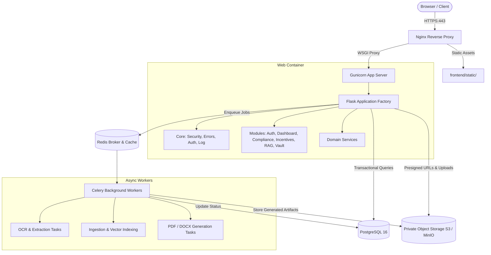

# Production Architecture Specification: MSME Navigator India

## 1. System Overview

MSME Navigator India is designed as a **production-grade modular monolith** providing regulatory compliance intelligence, government incentive discovery, AI-assisted document drafting, multilingual translation, and official document RAG grounded in verified circulars.



## 2. Directory Structure

```text
msme/
├── backend/                  # Application core, models, modules, services, tasks
│   ├── config.py             # Multi-environment configurations with validation
│   ├── extensions.py         # SQLAlchemy & Flask-Migrate
│   ├── core/                 # Errors, security headers, logging, permissions, middleware
│   ├── models/               # Domain models (tenant, company, document, compliance, etc.)
│   ├── modules/              # Blueprints & controllers
│   ├── services/             # Storage, translation, rules engine, RAG, document generator
│   └── tasks/                # Celery application & asynchronous worker jobs
├── frontend/                 # Separated presentation assets
│   ├── templates/            # Jinja templates (base, dashboard, onboarding, auth, admin)
│   └── static/               # CSS, JS, locales (NO customer files or generated docs)
├── documentation/            # Architectural, storage, deployment, security manuals
├── scripts/                  # Operational backup, restore, health check, deploy scripts
├── compose.yaml              # Local development compose
├── compose.production.yaml   # Production multi-container compose
├── Dockerfile                # Production non-root multi-stage container
├── requirements.txt          # Pinned production dependencies
└── wsgi.py                   # Gunicorn entrypoint
```
